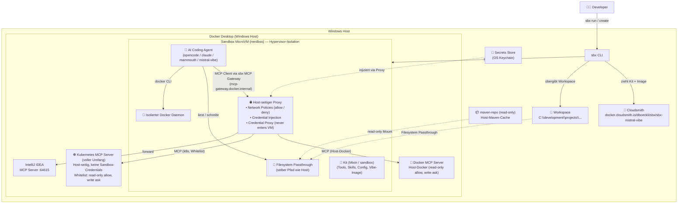
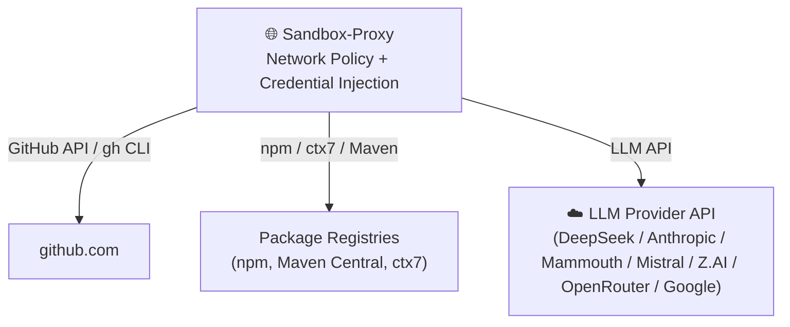

# opencode-sandbox-kit

[](https://github.com/dboeckli/opencode-sandbox-kit/actions/workflows/validate.yml)
[](https://github.com/dboeckli/opencode-sandbox-kit/actions/workflows/e2e.yml)

> **Canonical repository: [Codeberg](https://codeberg.org/dboeckli/opencode-sandbox-kit).** The
> [GitHub repo](https://github.com/dboeckli/opencode-sandbox-kit) is a **read-only mirror** — direct
> pushes/PRs there are ignored and overwritten on the next sync. Please use **Codeberg** for issues,
> pull requests and releases.

Docker Sandbox Kit (mixin) for OpenCode / Mammouth Code / Claude Code / Mistral Vibe, tailored to the Spring Boot ecosystem — ctx7 plus IntelliJ/Kubernetes/Host-Docker MCP via the sbx MCP Gateway, with pre-baked Java/Maven build tooling.

Enthält zusätzlich dedizierte Agent-Kits:

- **Mammouth Code** — `mammouth-agent/` (`kind: sandbox`), eigenes Image `docker.cloudsmith.io/dboeckli/sbx/sbx-mammouth`, entrypoint `mammouth`.
- **Mistral Vibe** — `mistral-vibe-agent/` (`kind: sandbox`), eigenes gepinntes Image, entrypoint `vibe --agent auto-approve`.

> **Setup-Anleitung:** [`INSTALL.md`](INSTALL.md) — Voraussetzungen, Docker-Desktop-Setup, IntelliJ MCP, Secrets (`sbx secret set`), Verifikation.

> **Troubleshooting & Caveats:** [`docs/troubleshooting.md`](docs/troubleshooting.md) — KVM/WSL2, IntelliJ-MCP, Mistral-Rate-Limits, Kit-Spec v2, Skills.

## Quickstart

### Lokale Entwicklung (opencode-sandbox-kit)

Zuerst ins geklonte Repo wechseln — die Kit-Pfade (`./opencode-agent/`, `./mammouth-agent/`, `./mistral-vibe-agent/`) sind relativ:

```powershell
cd C:\development\projects\opencode-sandbox-kit
```

Vor dem lokalen Start einmalig die Run-Config `build-and-publish-<agent>-image` ausführen — sie baut/pusht den Tag `:local`:

- [`build-and-publish-opencode-image`](.run/build-and-publish-opencode-image.run.xml)
- [`build-and-publish-claude-image`](.run/build-and-publish-claude-image.run.xml)
- [`build-and-publish-mammouth-image`](.run/build-and-publish-mammouth-image.run.xml)
- [`build-and-publish-mistral-vibe-image`](.run/build-and-publish-mistral-vibe-image.run.xml)

**OpenCode:**

```powershell
sbx run opencode `
    --kit ./opencode-agent/ `
    --template docker.cloudsmith.io/dboeckli/sbx/sbx-opencode-tooling:local `
    --skills=off `
    --static-mcp idea,k8s,docker `
    . `
    "C:\development\maven-repo:ro"
```

**Claude Code:**

```powershell
sbx run claude `
    --kit ./opencode-agent/ `
    --template docker.cloudsmith.io/dboeckli/sbx/sbx-claude-tooling:local `
    --skills=off `
    --static-mcp idea,k8s,docker `
    . `
    "C:\development\maven-repo:ro"
```

**Mammouth Code** (eigenes Image `docker.cloudsmith.io/dboeckli/sbx/sbx-mammouth`):

```powershell
sbx run ./mammouth-agent/ `
    --kit-arg imageTag=local `
    --skills=off `
    --static-mcp idea,k8s,docker `
    . `
    "C:\development\maven-repo:ro"
```

**Mistral Vibe** (eigenes gepinntes Image `docker.cloudsmith.io/dboeckli/sbx/sbx-mistral-vibe:<vibe-version>`):

```powershell
sbx run ./mistral-vibe-agent/ `
    --kit-arg imageTag=local `
    --skills=off `
    --static-mcp idea,k8s,docker `
    . `
    "C:\development\maven-repo:ro"
```

> **`--skills=off` (Pflicht):** Alle Sandboxes werden mit `--skills=off` erstellt — der
> Host-übergreifende **Shared-Skills-Store** (`…/DockerSandboxes/sandboxes/state/agent-skills`) wird
> **nicht** eingebunden. Seit sbx v0.43 ist der Default `readonly` (Store read-only gemountet); `off`
> schaltet ihn ganz ab. Die Sandbox bleibt damit außerhalb der geteilten Trust-Boundary;
> die Kit-Skills kommen ausschließlich aus `github.com/dboeckli/ai-agent-skills` (via
> `install-tooling-user.sh`), **nicht** vom Host. Das Flag wirkt nur bei der Sandbox-Erstellung
> (`sbx run`/`sbx create`) — bestehende Sandboxes müssen neu erstellt werden.
> Doku: https://docs.docker.com/ai/sandboxes/workflows/agent-skills/

### Kit direkt aus Codeberg (ohne Clone)

Einmalig `kit.allowedSources` setzen (siehe INSTALL.md). OpenCode/Claude nutzen das Release-Image `:latest` via `--template`.

Ins Projekt wechseln (wird als Workspace gemountet):

```powershell
cd C:\development\projects\mein-projekt
```

**OpenCode:**

```powershell
sbx run opencode `
    --kit "git+https://codeberg.org/dboeckli/opencode-sandbox-kit.git#dir=opencode-agent" `
    --template docker.cloudsmith.io/dboeckli/sbx/sbx-opencode-tooling:latest `
    --skills=off `
    --static-mcp idea,k8s,docker `
    . `
    "C:\development\maven-repo:ro"
```

**Claude Code:**

```powershell
sbx run claude `
    --kit "git+https://codeberg.org/dboeckli/opencode-sandbox-kit.git#dir=opencode-agent" `
    --template docker.cloudsmith.io/dboeckli/sbx/sbx-claude-tooling:latest `
    --skills=off `
    --static-mcp idea,k8s,docker `
    . `
    "C:\development\maven-repo:ro"
```

**Mammouth Code:**

```powershell
sbx run "git+https://codeberg.org/dboeckli/opencode-sandbox-kit.git#dir=mammouth-agent" `
    --kit-arg imageTag=latest `
    --skills=off `
    --static-mcp idea,k8s,docker `
    . `
    "C:\development\maven-repo:ro"
```

**Mistral Vibe:**

```powershell
sbx run "git+https://codeberg.org/dboeckli/opencode-sandbox-kit.git#dir=mistral-vibe-agent" `
    --kit-arg imageTag=latest `
    --skills=off `
    --static-mcp idea,k8s,docker `
    . `
    "C:\development\maven-repo:ro"
```

### Template-Version & Tooling-Image-Tags (gepinnt, Renovate-managed)

Alle Kits nutzen die Template-Version **`0.x.0`** (`TEMPLATE_VERSION`, Renovate-managed):

- **OpenCode**: `docker.cloudsmith.io/dboeckli/sbx/sbx-opencode-tooling:<tag>` — eigenes Tooling-Image, baut auf `docker/sandbox-templates:opencode-docker-0.x.0` auf (Tooling vorgebacken, Issue #137)
- **Claude (Home)**: `docker.cloudsmith.io/dboeckli/sbx/sbx-claude-tooling:<tag>` — eigenes Tooling-Image, baut auf `docker/sandbox-templates:claude-code-docker-0.x.0` auf (Issue #137)
- **Mammouth**: `docker.cloudsmith.io/dboeckli/sbx/sbx-mammouth:<tag>` — eigenes Image, baut auf `docker/sandbox-templates:opencode-docker-0.x.0` auf (Tooling **+ Mammouth-CLI** vorgebacken, Issue #137)
- **Mistral Vibe**: `docker.cloudsmith.io/dboeckli/sbx/sbx-mistral-vibe:<tag>` — eigenes Image, baut auf `docker/sandbox-templates:shell-docker-0.x.0` auf (`<tag>` = Vibe-Version)

Die Base-Version `0.x.0` ist mehrfach gepinnt und wird auf Konsistenz geprüft: als Konstante in `local-test/local-test-kits.py`
(Renovate-managed), als `TEMPLATE_VERSION` in `.github/workflows/validate.yml` + `e2e.yml` (Renovate-managed),
als `ARG BASE_IMAGE` in `opencode-agent/opencode/Dockerfile`, `opencode-agent/claude/Dockerfile` und
`mammouth-agent/Dockerfile`.
`python local-test/local-test-kits.py --validate-only` **warnt** (gelb) bei neueren Docker-Hub-Tags und schlägt
bei Drift fehl.

**Image-Tags** — Schema für alle Tooling-/Agent-Images; `<version>` = `TEMPLATE_VERSION` (OpenCode/Claude/Mammouth)
bzw. die Agent-Version (Mistral Vibe), `<branch-slug>` = Branch-Name (lowercase), `<timestamp>` = UTC `YYYYMMDDHHMMSS`:

| Kontext | Tag(s) |
|---------|--------|
| Lokal (Run-Config `build-and-publish-<name>-image`) | `<version>-<branch-slug>.<timestamp>` + `:local` |
| master/main (CI) | `<version>` + `:latest` |
| Feature-Branch / PR (CI) | `<version>-<branch-slug>.<timestamp>` + `<branch-slug>` |

Die Images müssen vor dem ersten Start **publiziert** sein — CI via `.github/workflows/build-and-publish-<name>-image.yml`
(`workflow_dispatch`/Push auf `master`), lokal via Run-Config `build-and-publish-<name>-image`. Für die **lokale
Entwicklung** daher `:local` verwenden (siehe „Lokale Entwicklung"); für Remote-Bezug `:latest`. Details: `AGENTS.md`
→ "Image-Versionierung (Tooling-/Agent-Images)".

### Registry umschalten (Cloudsmith ↔ Docker Hub)

Der Image-Prefix (Registry + Namespace [+ Repo]) ist **zentral** über `IMAGE_PREFIX` steuerbar — ein Umschalter, um
z. B. bei erschöpfter Cloudsmith-Quote temporär nach Docker Hub zu wechseln (`<IMAGE_PREFIX>/sbx-<name>:<tag>`):

| Registry | `IMAGE_PREFIX` |
|----------|----------------|
| Cloudsmith (**Default**) | `docker.cloudsmith.io/dboeckli/sbx` |
| Docker Hub | `docker.io/<dockerhub-user>` (z. B. `docker.io/domboeckli`) |

Gesetzt wird er an drei Stellen (identischer Wert, Pfad-Komposition ist registry-unabhängig):

1. **CI** — GitHub-**Repo-Variable** `IMAGE_PREFIX` (`.github/workflows/build-and-publish-*-image.yml` + `e2e.yml`
   lesen `vars.IMAGE_PREFIX || 'docker.cloudsmith.io/dboeckli/sbx'`). Fehlt sie → Cloudsmith-Default.
2. **Lokal/e2e-Runner** — Env `IMAGE_PREFIX` (`local-test/local-test-kits.py`, `local-test/build-and-publish-*.py`).
3. **Sandbox-Kits** — `--kit-arg imagePrefix=<prefix>` (`mammouth-agent/spec.yaml`/`mistral-vibe-agent/spec.yaml`
   → `args.imagePrefix`, Default Cloudsmith); CI/e2e/local-test übergeben ihn automatisch.

Fertige `sbx run`-Kommandos für die Docker-Hub-Images (4 lokal + 4 remote): [`docs/dockerhub-images.md`](docs/dockerhub-images.md).

**Zurück zu Cloudsmith** = Repo-Variable `IMAGE_PREFIX` löschen/auf den Default setzen (lokale Env unset) — die
Defaults in den Workflows/Specs bleiben Cloudsmith. `cleanup-cloudsmith.yml` läuft nur im Cloudsmith-Modus.
Der Cloudsmith-**API**-Service (`api.cloudsmith.io`, Helm-OCI) ist davon unberührt.

#### Zurück nach Cloudsmith (Prozedur)

Cloudsmith nur zurückwechseln, wenn die OSS-Quote wieder frei ist (Bandwidth = 100 % ⇒ Downloads liefern `HTTP 402`).

```bash
# 1. Quota prüfen (RESET des 30-Tage-Fensters abwarten; angezeigt unter /v1/quota/oss/dboeckli/)
curl -s -H "X-Api-Key: $CLOUDSMITH_API_KEY" https://api.cloudsmith.io/v1/quota/oss/dboeckli/
#    -> bandwidth percentage_used < 100 (inkl. Puffer für den nächsten e2e-Lauf)

# 2. Umschalter zurück (Repo-Variable löschen -> Cloudsmith-Default; oder explizit setzen)
gh variable delete IMAGE_PREFIX --repo dboeckli/opencode-sandbox-kit
# gh variable set IMAGE_PREFIX --body "docker.cloudsmith.io/dboeckli/sbx" --repo dboeckli/opencode-sandbox-kit
```

3. **Cloudsmith-Images auffrischen** — Merge/`workflow_dispatch` auf `master`: die 4 `build-and-publish-*` pushen
   `<pin>` + `latest` wieder nach Cloudsmith (die alten Cloudsmith-Images sind vom Stand vor dem Switch).
4. **Lokal/Ad-hoc:** ein evtl. gesetztes `IMAGE_PREFIX=docker.io/...` unset; manuelle
   `sbx run --template domboeckli/sbx-...` → zurück auf `docker.cloudsmith.io/dboeckli/sbx/sbx-...`.
5. **Docker-Hub-Images:** können liegen bleiben (kein Cleanup-Workflow; optional manuell löschen).

Automatisch wieder aktiv: Cloudsmith-Registry-Credential im e2e (`CLOUDSMITH_USERNAME`/`CLOUDSMITH_API_KEY`) und
`cleanup-cloudsmith.yml`.

### Ubuntu-WSL

Windows-Pfade im WSL-Format (`/mnt/c/...`) verwenden; ins Projekt wechseln (wird als Workspace gemountet):

```bash
cd /mnt/c/development/projects/spring-6-reactive
```

**OpenCode:**

```bash
sbx run opencode \
    --kit "git+https://codeberg.org/dboeckli/opencode-sandbox-kit.git#dir=opencode-agent" \
    --template docker.cloudsmith.io/dboeckli/sbx/sbx-opencode-tooling:latest \
    --skills=off \
    --static-mcp idea,k8s,docker \
    . \
    "/mnt/c/development/maven-repo:ro"
```

**Claude Code:**

```bash
sbx run claude \
    --kit "git+https://codeberg.org/dboeckli/opencode-sandbox-kit.git#dir=opencode-agent" \
    --template docker.cloudsmith.io/dboeckli/sbx/sbx-claude-tooling:latest \
    --skills=off \
    --static-mcp idea,k8s,docker \
    . \
    "/mnt/c/development/maven-repo:ro"
```

**Mammouth Code:**

```bash
sbx run "git+https://codeberg.org/dboeckli/opencode-sandbox-kit.git#dir=mammouth-agent" \
    --kit-arg imageTag=latest \
    --skills=off \
    --static-mcp idea,k8s,docker \
    . \
    "/mnt/c/development/maven-repo:ro"
```

**Mistral Vibe:**

```bash
sbx run "git+https://codeberg.org/dboeckli/opencode-sandbox-kit.git#dir=mistral-vibe-agent" \
    --kit-arg imageTag=latest \
    --skills=off \
    --static-mcp idea,k8s,docker \
    . \
    "/mnt/c/development/maven-repo:ro"
```

### Kit auf eine bestehende Sandbox anwenden

Restartet die Sandbox, VM-State bleibt — OpenCode/Claude nutzen das `opencode-agent`-Kit, Mammouth das `mammouth-agent`-Kit, Mistral Vibe das `mistral-vibe-agent`-Kit:

```powershell
sbx kit add <sandbox-name> `
    "git+https://codeberg.org/dboeckli/opencode-sandbox-kit.git#dir=opencode-agent"
```

```powershell
sbx kit add <sandbox-name> `
    "git+https://codeberg.org/dboeckli/opencode-sandbox-kit.git#dir=mammouth-agent"
```

```powershell
sbx kit add <sandbox-name> `
    "git+https://codeberg.org/dboeckli/opencode-sandbox-kit.git#dir=mistral-vibe-agent"
```

Die Sandbox ist eine MicroVM (nerdbox) mit Hypervisor-Isolation, die `sbx` über Docker Desktop orchestriert — kein Container im Host-Daemon. Der IntelliJ-MCP-Server läuft auf dem Host (`localhost:64615`, Port 64615 seit IDEA 2026.2.2) und wird über den **sbx MCP Gateway** (`mcp-gateway.docker.internal`, host-seitig registriert via `sbx mcp add`) in die Sandbox geliefert.

## Architektur



**Externe Ziele (über den Sandbox-Proxy):**



## MCP-Server (Host)

Drei host-seitige MCP-Server werden über den **sbx MCP Gateway** in die Sandbox geliefert (keine `mcp.*`-Konfiguration im Kit; der Gateway erscheint als `mcp-gateway` in der Agent-MCP-Liste). Einmalig host-seitig registrieren, dann die Sandbox mit `--static-mcp` erzeugen:

| Server | Host | Registrierung (einmalig, PowerShell) |
|--------|------|--------------------------------------|
| **IntelliJ MCP** | IntelliJ IDEA (JetBrains MCP Server, Port `64615` seit IDEA 2026.2.2, Endpoint `/stream`) | `sbx mcp add idea --url http://localhost:64615/stream --skip-ssrf-check` |
| **Kubernetes** | `kubernetes-mcp-server` (voller Umfang, alle Toolsets; keine Sandbox-Credentials) | `sbx mcp add k8s --command "$env:USERPROFILE\.local\bin\kubernetes-mcp-server.exe" --args "--config,$env:USERPROFILE\.config\kubernetes-mcp-server\config.toml"` |
| **Docker** | `ckreiling/mcp-server-docker` via `uvx` (steuert den Host-Docker-Daemon) | `sbx mcp add docker --command (Get-Command uvx).Source --args "mcp-server-docker==0.3.0"` |

```powershell
sbx run opencode `
    --kit ./opencode-agent/ `
    --template docker.cloudsmith.io/dboeckli/sbx/sbx-opencode-tooling:local `
    --skills=off `
    --static-mcp idea,k8s,docker
```

Nachträglich in eine laufende Sandbox laden: `sbx mcp load <name> --sandbox <sandbox-name>`. Die Tools erscheinen als `mcp-gateway_<tool>` (OpenCode/Mammouth/Mistral Vibe) bzw. `mcp__mcp-gateway__<tool>` (Claude Code).

**Permission-Modell:** Deny-by-default — nur lesende MCP-Tools sind `allow`; K8s-/Docker-Schreib-/Exec-Tools sind bei OpenCode/Mammouth/Claude `ask` (Freigabe pro Aufruf), bei Mistral Vibe hart `deny` (auto-approve-Hook). `configuration_view` ist gesperrt (würde die Host-`kubeconfig` in die Sandbox liefern).

Details: [Kubernetes-MCP-Server](docs/kubernetes-mcp-server.md) · [Docker-MCP-Server (Host)](docs/docker-mcp-server.md) · [IntelliJ MCP Port-Analyse](docs/intellij-mcp-port.md).

## Dual Agent Support

Das Kit funktioniert mit **OpenCode, Claude Code, Mammouth Code und Mistral Vibe** – der Agent wird nicht vom Kit bestimmt,
sondern vom Template bzw. dem Kit-Image beim `sbx run`:

| Agent | Template | Kit |
|-------|----------|-----|
| OpenCode | `docker.cloudsmith.io/dboeckli/sbx/sbx-opencode-tooling` (baut auf `opencode-docker-0.x.0` auf) | `opencode-agent/` (Mixin) |
| Claude Code | `docker.cloudsmith.io/dboeckli/sbx/sbx-claude-tooling` (baut auf `claude-code-docker-0.x.0` auf) | `opencode-agent/` (Mixin) |
| Mammouth Code | `opencode-docker` (Pin `0.x.0`) | `mammouth-agent/` (`kind: sandbox`, Pin im spec-Image) |
| Mistral Vibe | `shell` (Pin `0.x.0`, im eigenen Image) | `mistral-vibe-agent/` (`kind: sandbox`, eigenes Image `docker.cloudsmith.io/dboeckli/sbx/sbx-mistral-vibe`) |

Die mehrzeiligen Start-Commands stehen im [Quickstart](#quickstart) oben.

> **Host-MCP-Server via sbx MCP Gateway:** IntelliJ MCP einmalig `sbx mcp add idea --url http://localhost:64615/stream --skip-ssrf-check`
> (Host-Loopback, SSRF-Guard umgehen); Kubernetes und Host-Docker via `sbx mcp add k8s …`/`sbx mcp add docker …`
> (`docs/kubernetes-mcp-server.md`, `docs/docker-mcp-server.md`). Dann `--static-mcp idea,k8s,docker` beim Erzeugen
> oder `sbx mcp load <name> --sandbox <sandbox-name>`.
> Alle vier erhalten dieselben Tools (JDK, Maven, Docker CLI, Helm, Apache Kafka CLI, Skills, ctx7) und die
> Host-MCP-Server (IntelliJ/Kubernetes/Docker) über den Gateway
> (`mcp-gateway_<tool>` in OpenCode/Mammouth/Mistral Vibe, `mcp__mcp-gateway__<tool>` in Claude Code). Die jeweilige
> Konfiguration wird automatisch gelesen:

- **OpenCode**: `~/.config/opencode/opencode.jsonc` + `~/.config/opencode/AGENTS.md` — Modell `deepseek/deepseek-flash` (DeepSeek V4.1 Flash); Zusatz-Provider `openrouter`, `google` und `zai` (GLM-5.3-Flash/GLM-5.3 via `ZAI_API_KEY`, `sbx secret set zai`)
- **Claude Code**: `~/.claude/settings.json` + `~/.claude/CLAUDE.md`
- **Mammouth Code**: `~/.config/mammouth/opencode.jsonc` + `~/.config/mammouth/AGENTS.md`
- **Mistral Vibe**: `~/.vibe/config.toml` (MCP-Gateway) + `~/.vibe/hooks.toml` (Read-only-Guard) + `~/.vibe/AGENTS.md`

### Mammouth Code Agent-Kit

[Mammouth Code](https://info.mammouth.ai/docs/mammouth-code/) ist ein Open-Source-Fork von OpenCode.
Da `sbx` keinen eingebauten `mammouth`-Agenten kennt, liegt unter `mammouth-agent/` ein **eigenes
Sandbox-Kit** (`kind: sandbox`, Name `mammouth`) – analog zum Amp-Beispiel aus der Docker-Doku:

- **Base-Image**: `docker/sandbox-templates:opencode-docker-0.x.0` (Mammouth ist ein OpenCode-Fork;
  Version gepinnt im `sandbox.image` der spec, siehe Abschnitt "Template-Version (gepinnt)")
- **Entrypoint**: `mammouth` (direkt, ohne Template-Umweg)
- **Auth**: `credentials[].apiKey` für `api.mammouth.ai` (`name: MAMMOUTH_API_KEY`, `proxyManaged: true`,
  `inject` als `Authorization: Bearer`) — kit-spec v2
- **Tools**: installiert dieselben Tools wie das Mixin-Kit (JDK, Maven, Docker CLI, kubectl, Helm, Apache Kafka CLI, ctx7, Skills)
- **Config**: `~/.config/mammouth/opencode.jsonc` + `~/.config/mammouth/AGENTS.md`

Die Konfiguration liegt unter `~/.config/mammouth/` (XDG-app `mammouth`):

- **Modell**: `deepseek/deepseek-flash` (DeepSeek V4.1 Flash) als Default
- **IntelliJ MCP**: über den sbx MCP Gateway (`mcp-gateway_<tool>`), keine direkte `mcp.idea`-Config
- **Plugins**: Startup-Checks + Auto-Session (identisch zu OpenCode, da Fork)
- **PATH**: `mammouth`-Binary via Symlink `/usr/local/bin/mammouth` aufgelöst; `JAVA_HOME` via Kit-`environment.variables` (v2)

**Installation** — das Image `docker.cloudsmith.io/dboeckli/sbx/sbx-mammouth` backt Mammouth beim **Image-Build**, gepinnt auf
**v1.18.31.1** (`ARG MAMMOUTH_VERSION` im `mammouth-agent/Dockerfile`, ausgeführt als User `agent`;
Pin via Renovate `mammouth-ai/code`; `local-test-kits.py --validate-only` warnt bei neuerem
GitHub-Release) und legt einen Symlink `/usr/local/bin/mammouth` an, damit der Entrypoint den
Agenten findet. Manuell nur nötig, wenn die Sandbox bereits läuft:

```bash
curl -fsSL https://code.mammouth.ai/install.sh | VERSION=1.18.31.1 bash
```

**Update/Uninstall:** `mammouth upgrade` bzw. `mammouth uninstall`.

> **Auth / Secret / Verifikation:** siehe [`INSTALL.md`](INSTALL.md#5-secrets-registrieren) — API-Key, `sbx secret set mammouth`, Platzhalter-Check.

### Mistral Vibe Agent-Kit

[Mistral Vibe](https://github.com/mistralai/mistral-vibe) ist Mistrals Open-Source-Coding-Agent (Python-CLI,
PyPI `mistral-vibe`). Da `sbx` keinen eingebauten `mistral-vibe`-Agenten kennt und Vibe kein vorgefertigtes
`docker/sandbox-templates`-Image ist, liegt unter `mistral-vibe-agent/` ein **eigenes Sandbox-Kit**
(`kind: sandbox`, Name `mistral-vibe`) — nach dem [Docker-Guide](https://docs.docker.com/guides/mistral-vibe-sandbox/):

- **Base-Image**: eigenes, gepinntes Image `docker.cloudsmith.io/dboeckli/sbx/sbx-mistral-vibe:<vibe-version>` — gebaut aus
  `docker/sandbox-templates:shell-docker-0.x.0` + `uv tool install mistral-vibe==<pin>` (siehe `mistral-vibe-agent/Dockerfile`).
  Publiziert **multi-arch (linux/amd64 + linux/arm64)** via
  `.github/workflows/build-and-publish-mistral-vibe-image.yml`: pro Architektur ein **nativer** Runner
  (`ubuntu-latest` / `ubuntu-24.04-arm`), Per-Arch-Image mit der Architektur im **Repo-Namen**
  (`docker.cloudsmith.io/dboeckli/sbx/sbx-mistral-vibe-amd64` / `-arm64`), danach Manifest-Merge zum Multi-Arch-Index unter
  `docker.cloudsmith.io/dboeckli/sbx/sbx-mistral-vibe` (`docker buildx imagetools create`; `uv tool install` läuft nicht unter QEMU-arm64).
- **Launch**: `sandbox.entrypoint: [vibe, "--agent", "auto-approve"]` in der spec (für `kind: sandbox` startet sbx ohne `entrypoint` die Default-Shell); das Dockerfile-`CMD` bleibt für `docker run`.
- **Auth**: Kit-deklarierter Service `mistral` → `MISTRAL_API_KEY` (Built-in-Service `mistral`, Sentinel
  `proxy-managed`, Proxy injiziert `Authorization: Bearer` für `api.mistral.ai`).
- **Default-Modell GLM-5.3-Flash (Z.AI)**: `~/.vibe/config.toml` setzt `active_model = "glm-flash"` und definiert
  Z.AI als OpenAI-kompatiblen Provider (`[[providers]]` `zai` → `https://api.z.ai/api/paas/v4`, `ZAI_API_KEY`;
  `[[models]]` `glm-flash` → `glm-5.3-flash`). GLM-5.3-Flash gibt es **nur direkt bei Z.AI** (nicht über Mistral);
  Kit-Service `zai` (`sbx secret set zai`, Key: https://z.ai/manage-apikey/apikey-list).
- **Alternative ohne Z.AI-Key**: Mistral hostet GLM 5.3 selbst (`zai-glm-5-3`, Alias `glm`, Provider `mistral`,
  gleiche `MISTRAL_API_KEY`) — in der TUI per `/model` wählbar.
- **Config**: `~/.vibe/config.toml` (MCP-Gateway auf `http://mcp-gateway.docker.internal/mcp` + GLM-Provider/-Modelle),
  `~/.vibe/hooks.toml` + `~/.config/sandbox-kit/vibe-mcp-guard.py` (Read-only-Guard für die IntelliJ-MCP-Tools,
  da `auto-approve` das Permission-System umgeht) und `~/.vibe/AGENTS.md`.
- **Tools**: dieselben wie die anderen Kits (JDK, Maven, Docker CLI, kubectl, Helm, Apache Kafka CLI, ctx7, Skills).

> **Modell-Verfügbarkeit (wichtig):** **GLM-5.3-Flash** (`glm-5.3-flash`) gibt es **nur direkt bei Z.AI**
> (`api.z.ai`, Provider `zai`, `ZAI_API_KEY`, `sbx secret set zai`) — **nicht über Mistral**. Über Mistral
> (la Plateforme) sind nur **`zai-glm-5-3`** und **`zai-glm-5-2`** verfügbar (Provider `mistral`, `MISTRAL_API_KEY`).
> Deshalb ist GLM-5.3-Flash der Default über den Z.AI-Provider; `glm` (Mistral-hosted `zai-glm-5-3`) ist die
> key-freie Alternative.

> **Image-Publish:** Das Image wird in CI gebaut (multi-arch amd64+arm64; native Runner + `imagetools create`). Der e2e-Workflow
> ruft den (auch manuell per `workflow_dispatch` startbaren) `build-and-publish-mistral-vibe-image.yml` als
> `publish-image`-Job **vor** der Szenario-Matrix auf. Gepusht wird nur auf `master`/`main`/Nightly (`push: true`);
> auf Branches/PRs läuft der Build nur (`push: false`) — der `e2e`-Job zieht dann das publizierte Master-`:latest`.
> Das **frisch gebaute Branch-Image** prüft der Build-Job selbst: er lädt es (`load`) und vergleicht `vibe --version`
> im Image mit `ARG VIBE_VERSION` (`docker run --entrypoint vibe  --version`). Manuell: Workflow
> `Publish Mistral Vibe image` → *Run workflow*.
>
> **Tags:** `master`/`main` → `<pin>` (z. B. `2.25.5`) **und** `latest`. Feature-Branch/PR (nur gebaut, nicht
> gepusht) würde semver-Prerelease `<pin>-<branch-slug>.<YYYYMMDDHHMMSS>` plus beweglicher Tag `<branch-slug>`
> tragen. Das `e2e`-Szenario nutzt auf `master`/Nightly den Release-Tag `<pin>` (per `--kit-arg imageTag=<tag>`,
> `spec.yaml` → `args.imageTag`), auf Branches/PRs das Master-`:latest`.
>
> **Lokal (Windows-Host):** IntelliJ-Run-Config **`build-and-publish-mistral-vibe-image`** (baut + pusht) — Tag wie beim
> Feature-Branch-Build (`<pin>-<branch-slug>.<timestamp>`, semver) **plus** beweglicher Tag `local`.
>
> Build + push + lokal laden:
> ```powershell
> python local-test\build-and-publish-mistral-vibe-image.py
> ```
> Nur pushen:
> ```powershell
> python local-test\build-and-publish-mistral-vibe-image.py --no-load
> ```
> Nur bauen:
> ```powershell
> python local-test\build-and-publish-mistral-vibe-image.py --build-only
> ```
> Neben dem Push in die Registry wird das Image in den **lokalen Docker-Daemon** geladen (zweiter,
> gecachter Build).
> Voraussetzung: `docker` (Docker Desktop) mit `docker login docker.cloudsmith.io` (Push nach Cloudsmith). Der Vibe-Pin und
> `args.imageTag.default` in `spec.yaml` werden per Renovate (PyPI `mistral-vibe`) gemeinsam aktualisiert.

> **Auth / Secret / Verifikation:** siehe [`INSTALL.md`](INSTALL.md#mistral-authentication) — `sbx secret set mistral`, Platzhalter-Check.

### Claude Code Konfiguration

`~/.claude/settings.json` enthält:

- **Modell**: `claude-sonnet-4-6` als Default (`"model"`). Zusätzlich per Env-Variablen abgesichert
  (`ANTHROPIC_DEFAULT_SONNET_MODEL` + `ANTHROPIC_MODEL` via Kit-`environment.variables`), damit das Template
  die settings.json nicht mit einem Default-Modell (Opus 5) überschreiben kann.
- **IntelliJ MCP**: über den sbx MCP Gateway (`mcp__mcp-gateway__<tool>`), keine direkte `mcpServers.idea`-Config
- **StatusLine**: `bash ~/.claude/statusline.sh` – zeigt Modell, Kontext-Tokens, Kosten, geänderte Zeilen und Session-Dauer
- **SessionStart-Hook**: führt die Sandbox-Checks aus und übergibt den Report als System-Message
  (StatusLine + Hooks liegen in `managed-settings.json` unter `/etc/claude-code/` – höchste Precedence,
  Template-sicher, kein Settings-Race beim Start, siehe [session-start-hook-fix.md](docs/session-start-hook-fix.md))
- **Permission-Whitelist + Run-Config-Guard**: siehe Abschnitt "IntelliJ MCP Zugriff einschränken"

> **Hinweis:** Das claude-code-docker-Template überschreibt `~/.claude/settings.json` beim Start (u.a. mit
> `apiKeyHelper: echo proxy-managed`, `defaultMode: bypassPermissions`). Der `setup.startup`-Merge stellt danach
> die Kit-Felder aus `settings.kit.json` sicher — u.a. `defaultMode: default` (damit `permissions.ask` für die
> K8s-Schreib-/Exec-Tools greift) und die Permission-Listen. Das Modell wird zusätzlich fest über die
> Env-Variablen erzwungen. Nach Änderungen am Kit die Sandbox neu erstellen (bzw. `sbx kit add`), damit die
> Env-Variablen greifen.

Die StatusLine (`~/.claude/statusline.sh`) wird beim Sandbox-Build aus
[dboeckli/ai-agent-skills](https://github.com/dboeckli/ai-agent-skills) installiert.

## Automatisierter Kit-Test

Die 4 Agent-Szenarien (OpenCode, Claude Home, Mammouth, Mistral Vibe) lassen sich lokal automatisiert testen —
`local-test-kits.py` (cross-platform, Windows + Linux/macOS) validiert alle Kits, prüft die
Secrets, baut pro Szenario eine Sandbox, prüft Tools/Config/Startup-Checks und räumt danach auf.

Als **Workspace** mounten die Szenarien den **Repo-Root** (`--workspace <pfad>` bzw. `$WORKSPACE_DIR`
übersteuert; Default ist nicht das Aufrufverzeichnis). Der Test startet den Agenten nicht und schreibt
nichts ins Workspace.

Alle 4 Szenarien (ohne `--keep`: Sandboxes werden wieder entfernt):

```bash
python local-test/local-test-kits.py
```

Sandboxes nach dem Test behalten:

```bash
python local-test/local-test-kits.py --keep
```

Nur Kit-Validierung, keine Sandboxes:

```bash
python local-test/local-test-kits.py --validate-only
```

Lokales Testen in **Windows PowerShell** (Docker Desktop nativ):

Alle 4 Szenarien (ohne `--keep`: Sandboxes werden wieder entfernt):

```powershell
python .\local-test\local-test-kits.py
```

Sandboxes nach dem Test behalten:

```powershell
python .\local-test\local-test-kits.py --keep
```

Nur Kit-Validierung, keine Sandboxes:

```powershell
python .\local-test\local-test-kits.py --validate-only
```

Voraussetzungen: Docker läuft (auf Windows nativ oder im Ubuntu-WSL-Setup), `sbx` im PATH,
globale Secrets gesetzt (`github`, `github-maven`, `anthropic`, `mammouth`, `mistral`, `context7`).
Das Mistral-Vibe-Szenario nutzt lokal den zuletzt **lokal** gebauten Stand (`<IMAGE_PREFIX>/sbx-mistral-vibe:local`, Default Cloudsmith, gesetzt von der Run-Config `build-and-publish-mistral-vibe-image`) — also vorher einmal `python local-test\build-and-publish-mistral-vibe-image.py` ausführen. CI/e2e nutzt dagegen `VIBE_IMAGE_TAG`: auf `master`/Nightly den Release-Tag `<pin>`, auf Branches/PRs das publizierte Master-`:latest` (das Branch-Image wird stattdessen im Build-Job auf den Pin geprüft).

### GitHub Actions (CI)

Die Tests laufen zusätzlich automatisiert in GitHub Actions (`.github/workflows/`):

- **`validate.yml`** — bei jedem Push/PR + nightly (03:00 UTC): installiert eine **gepinnte `sbx`-Version**
  (`SBX_VERSION`, aktuell `v0.47.0`), meldet sich via `sbx login` an Docker an (`DOCKER_USERNAME`/`DOCKER_PAT`,
  mit Secret-Service-Setup — sbx >= v0.47.0 verlangt eine Docker-Session für `sbx kit validate`; bei Fork-PRs
  übersprungen, da keine Secrets), validiert alle Kits (`sbx kit validate ./opencode-agent/`,
  `./mammouth-agent/`, `./mistral-vibe-agent/`) und prüft, dass die Install-Skript-Kopien
  (`files/home/.local/bin/`) in allen Kits identisch sind, sowie dass der Vibe-Image-Tag in
  `mistral-vibe-agent/spec.yaml` zum `ARG VIBE_VERSION` im Dockerfile passt.
- **`e2e.yml`** — bei jedem Push/PR + wöchentlich Montag (03:05 UTC, nach `validate.yml`): baut echte Sandboxes für
  alle 4 Szenarien (`local-test-kits.py opencode|claude|mammouth|mistral-vibe --ci`) mit KVM-Zugriff,
  `sbx login` (`DOCKER_USERNAME`/`DOCKER_PAT`) + Cloudsmith-Registry-Credential (`CLOUDSMITH_USERNAME`/`CLOUDSMITH_API_KEY`, nur wenn `IMAGE_PREFIX` auf Cloudsmith zeigt) und Fake-API-Keys (nur Proxy-Wiring, keine echten Calls).
  Fork-PRs laufen nicht (keine Secrets-Exposition).
- **`build-and-publish-mistral-vibe-image.yml`** — baut/publiziert das gepinnte Vibe-Image (multi-arch amd64+arm64 über native Runner + `imagetools create`)
  unter `<IMAGE_PREFIX>` (Default Cloudsmith; Docker Hub via Repo-Variable `IMAGE_PREFIX` — siehe „Registry umschalten"). Wird vom `e2e`-Workflow als `publish-image`-Job vor der Matrix aufgerufen; zusätzlich manuell
  via `workflow_dispatch` (Build-only möglich über den `push`-Input). Bei `push: false` (Branch/PR) lädt der Build das Image (`load`) und ein Verify-Step prüft die eingebackene Vibe-Version gegen `ARG VIBE_VERSION`
  (`docker run --entrypoint vibe  --version`); analog prüft `build-and-publish-mammouth-image.yml` die Mammouth-CLI-Version gegen `ARG MAMMOUTH_VERSION`.
- **`cleanup-cloudsmith.yml`** — **nur Cloudsmith-Modus** (`IMAGE_PREFIX` startet mit `docker.cloudsmith.io`); löscht Feature-Branch-Image-Snapshots aus `dboeckli/sbx`
  (Tag-Muster `<basever>-<branch-slug>.<YYYYMMDDHHMMSS>` + Moving-Tag `<slug>`; Master-Images
  `<basever>`/`latest` bleiben). Auslöser: **push auf `master`** (Feature-Images nach dem Merge
  obsolet → alle löschen), **nightly 04:25 UTC** (verwaiste Snapshots älter als `max-age-days`) und
  `workflow_dispatch` mit `dry-run` (Default an). Skript:
  `.github/workflows/scripts/cleanup-cloudsmith.py` (analog zu `spring-6-rest-mvc`).
  Zusätzlich werden **untagged Kind-Manifeste** (Plattform/Attestation) gelöscht, die von **keinem**
  verbleibenden Index mehr referenziert werden (echte Orphans); Live-Images (`<basever>`/`latest`)
  bleiben unangetastet (Referenz-Check via Registry-API, fail-safe).
  In den Image-Builds ist `provenance`/`sbom` **deaktiviert** (keine Attestation-Manifeste → weniger
  Package-Bloat).
  Zusätzlich leert die Pipeline den **Recycle Bin** (`purge-cloudsmith-recycle-bin.py`, hard delete):
  soft-gelöschte Packages zählen 7 Tage weiter gegen das Storage-Kontingent; endgültiges Löschen gibt
  Speicher sofort frei (via `purge-recycle-bin` steuerbar, Default an).

> Die **gepinnte `sbx`-Version** (`SBX_VERSION`) wird von Renovate aktualisiert
> (`customManager` für `docker/sbx-releases`, `github-releases`-Datasource).
>
> Die Offline-Referenz `opencode-agent/files/home/sbx-cli.md` (→ `~/sbx-cli.md` in der Sandbox) wird per
> `python local-test/regenerate-sbx-doc.py [<version>]` aus der Release-Binary neu erzeugt
> (Default: `SBX_VERSION` aus `validate.yml`). `local-test-kits.py --validate-only` vergleicht die
> dokumentierte Version mit dem gepinnten `SBX_VERSION` und schlägt fehl bei Abweichung
> (inkl. Hinweis aufs Regen-Skript).
>
> `--validate-only` prüft zusätzlich die **Template-Pin** (explizite `TEMPLATE_VERSION`-Konstante in
> `local-test-kits.py`, Drift-Check gegen `TEMPLATE_VERSION` in `.github/workflows/validate.yml`/`e2e.yml`
> und das Mammouth-spec-Image) gegen die Docker-Hub-Tags (`docker/sandbox-templates`), die
> **Mammouth-CLI-Pin** (`VERSION=` im spec-install) gegen das latest GitHub-Release (`mammouth-ai/code`)
> und die **Mistral-Vibe-Pin** (`ARG VIBE_VERSION` im Dockerfile, Image-Tag in der spec, shell-Basis-Template)
> gegen die latest PyPI-Version (`mistral-vibe`) — alle **warnen** (gelb), sobald eine neuere Version
> existiert (Renovate-Tracking, s. o.).

## Startup Checks

Beim Start jeder Session prüft das Kit automatisch die Tooling-Verfügbarkeit
(Context7, IntelliJ MCP, gh, Java/Maven, Docker, kubectl, MCP-Gateway/IntelliJ/Kubernetes, Helm, Kafka, Skills, SonarCloud) und zeigt den
Report als `[startup-checks] ...` an:

```
[startup-checks] ctx7:OK intellij-mcp:OK gh:OK java/maven:OK docker:OK kubectl:OK mcp-gateway:OK mcp-idea:OK mcp-k8s:OK mcp-docker:OK helm:OK kafka:OK skills:OK sonar:OK
```

- **OpenCode**: Ein Server-Plugin führt die Checks sofort beim Start aus, injiziert den Report in den
  System-Prompt und schreibt ihn nach `~/.config/sandbox-kit/startup-checks.report`. Ein TUI-Plugin
  (Auto-Session) startet direkt im Session-View, sodass die Sidebar mit den Blöcken **Startup checks**,
  **Skills** und **MCP & Host Systems** sofort sichtbar ist – ohne ersten Prompt. Der
  **MCP & Host Systems**-Block zeigt live (alle 10s, via `~/.config/sandbox-kit/check-infra.sh`) die
  **MCP-Server** über den sbx-Gateway (`~/.local/bin/mcp-check.sh`: ein MCP-Handshake → `mcp-gateway`, `mcp-idea`,
  `mcp-k8s`, `mcp-docker`; die Sandbox hält **keine** kubeconfig (Issue #40) und **keinen** Host-Docker-Port
  (Issue #165)). MCP-Server stehen in einer Zeile. Gebounded per `timeout`.
- **Claude Code**: Ein `SessionStart`-Hook übergibt den Report als System-Message (registriert in `managed-settings.json` unter `/etc/claude-code/`).
- **Mammouth Code** (Agent-Kit): Da Fork von OpenCode, werden dieselben Server-/TUI-Plugins aus `~/.config/mammouth/plugins/` geladen.
- **Mistral Vibe** (Agent-Kit): Kein Auto-Hook (Vibe hat keinen Session-Hook für den Report) — die Checks laufen manuell; `check-infra.sh` ist nur der Parity wegen enthalten.
- **Manuell**: `bash ~/.config/sandbox-kit/run-checks.sh`
- **Referenz**: `~/.config/sandbox-kit/startup-checks.md`

Der Agent bestätigt den Status in der ersten Antwort und schlägt bei einem `FAIL` einen Fix vor.

## Installierte Tools

| Tool | Version | Installiert in |
|------|---------|---------------|
| Node.js | 24.21.0 (LTS) | `/opt/node` → Symlinks in `/usr/local/bin` (npm-CLIs wie renovate ≥43) |
| Liberica JDK | 25.0.4 | `/usr/local/java` |
| Apache Maven | 3.9.16 | `/opt/maven` |
| Docker CLI | 27.5.1 | `/usr/local/bin/docker` |
| Docker Compose | 5.4.0 (Plugin) | `/usr/local/lib/docker/cli-plugins/docker-compose` |
| kubectl | latest stable | `/usr/local/bin/kubectl` |
| Helm | 3.22.0 (v3) + 4.3.0 (v4) | `/usr/local/bin/helm`, `/usr/local/bin/helm4` |
| Apache Kafka CLI | 4.3.1 (Scala 2.13) | `/opt/kafka` + `kafka-*.sh`-Wrapper in `/usr/local/bin` |
| ctx7 | latest | npm global |
| skills | 1.5.21 | npm global (vercel-labs) |
| renovate | latest | npm global |
| jq | distro | apt (StatusLine-Abhängigkeit) |

`JAVA_HOME` wird via Kit-`environment.variables` in jeder Shell verfügbar gemacht (Java/Maven liegen über
Symlinks bereits in `/usr/local/bin` und damit auf dem PATH).

## Skills

Das Kit installiert automatisch Skills aus [dboeckli/ai-agent-skills](https://github.com/dboeckli/ai-agent-skills) via `skills add -g --all`. Installierte Skills:

- **camel-matrix** — Camel Spring Boot Kompatibilitätsmatrix
- **cc-best-practices** — Claude Code Best Practices
- **cron-schedule-planner** — GitHub-Actions-Cron-Zeitpläne: Übersicht, Kollisionen, Umverteilung
- **project-references** — Referenzprojekt-Suche
- **skill-best-practices** — SKILL.md Schreib-Guide

Skills landen in `~/.agents/skills/` (werden als `user: "1000"` installiert).

> **API-Keys & Secrets:** [`INSTALL.md`](INSTALL.md#5-secrets-registrieren) — alle Services (`sbx secret set`), Konsolen-URLs, Proxy/Platzhalter-Details, Verifikation.

## References

- [Debugging, Analyzing & Logging](docs/debugging-analysis-logging.md)
- [Kubernetes-MCP-Server](docs/kubernetes-mcp-server.md)
- [Docker-MCP-Server (Host)](docs/docker-mcp-server.md)
- [IntelliJ MCP Port-Analyse](docs/intellij-mcp-port.md)
- [Session-Start-Hook-Fix (Claude)](docs/session-start-hook-fix.md)
- [sbx CLI Offline-Referenz](opencode-agent/files/home/sbx-cli.md) (`~/sbx-cli.md` in der Sandbox, v0.47.0 — generiert aus der Release-Binary)
- [Codeberg Repo](https://codeberg.org/dboeckli/opencode-sandbox-kit) (kanonisch) — GitHub-Mirror: <https://github.com/dboeckli/opencode-sandbox-kit>
- [Codeberg/Forgejo-Betriebshinweise](docs/codeberg-forgejo.md)
- [Docker Sandbox Kits](https://docs.docker.com/ai/sandboxes/customize/kits/)
- [Kit Spec Reference](https://docs.docker.com/ai/sandboxes/customize/kit-reference/)
- [Docker Blog — AI Coding Agent Horror Stories: Security Risks](https://www.docker.com/blog/ai-coding-agent-horror-stories-security-risks/)
